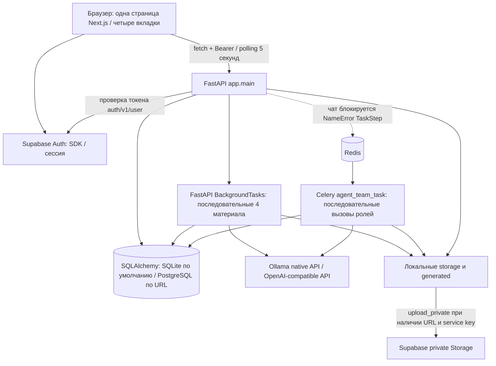

# AI EDU 2.0 — технический аудит

Дата: 5 ноября 2026, Asia/Almaty. Объект: `/Users/esimkhanramazanov/projects/AiEdu`.

## 1. Executive Summary

**Вердикт: локальный прототип с проверенным приёмом DOCX и навигацией; полноценная генерация, облачная интеграция и готовность SaaS не подтверждены. Публичный запуск преждевременен.** Для конференции можно показывать существующий кабинет и загрузку/подтверждение РУП с прямым обозначением ограничений. Демонстрация реальной работы четырёх агентов сейчас не готова.

- Выполнено: 9 штатных backend-тестов, 3 штатных Playwright-теста, TypeScript typecheck, реальные HTTP health-check; дополнительные локальные проверки загрузки, подтверждения, изоляции, ошибок и форматов экспорта.
- Подтверждены блокеры: `TaskStep` не импортирован в API; чат с полными исходными данными и непустой список задач падают с 500. XLSX-парсер падает. Табличная РУП распознаётся с ложными темами и неверной связью часов. Облачные файлы не обновляются после редактирования материала.
- Ollama отвечает, но `/api/tags` вернул `models: []`; настроенная модель `qwen2.5:7b` не установлена. Реальная генерация не состоялась. Облачные платные вызовы не выполнялись.
- Виртуального офиса, персонажей, анимации, интерфейса командного чата и realtime-канала нет.
- Критический риск публикации: публичный `/llm/status` при облачном провайдере сам делает платный запрос без авторизации и лимитов. Браузер опрашивает его каждые 5 секунд.
- Исходники не изменялись; создан только этот отчёт. Проверки с записью выполнялись во временной копии и временной SQLite; действующие серверы не останавливались. Старый LessonAi не исследовался и не изменялся.

### Методика и сила доказательств

**К** — подтверждено исходным кодом; **Т** — подтверждено выполненным тестом; **Н** — не удалось проверить. ✅ означает только проверенный объём, а не гарантию для произвольных документов/нагрузки. 🟡 — частично; 🔴 — отсутствует; ⚪ — код есть, работоспособность не подтверждена.

Изолированная проверка API использовала настоящий FastAPI TestClient, настоящие библиотеки DOCX/PPTX и временную SQLite. Подмена `get_user_id` задавала двух тестовых владельцев; это проверяет фильтры API, **не Supabase Auth или RLS**. LLM не подменялась успешной генерацией. Штатный `test_ollama.py` использует FakeClient — его успех доказывает только форму запроса.

Исходное состояние Git: `git ls-files` не вернул отслеживаемых файлов; основные каталоги отображаются как untracked. Поэтому commit/ревизию для воспроизводимости привязать нельзя. Старый `docs/conference/runtime-validation-report.md` рассматривался как историческое заявление, не доказательство текущей работоспособности.

## 2. Фактическая архитектура

Это схема связей в коде, а не подтверждение запуска всех сервисов. Тестами подтверждены Next.js → API (чтение), API → временная SQLite, DOCX → извлечение → подтверждение → БД, локальные экспортёры. Supabase, Redis/worker и реальная LLM-генерация end-to-end не подтверждены.

### Компоненты и связь

| Компонент | Фактическая реализация и ограничение | Источник |
|---|---|---|
| Frontend | Next.js 16.4.3 установлен, React 19, TS, Tailwind. Единственная client page, переключение вкладок через useState, без отдельных маршрутов | `frontend/package.json`, `src/app/page.tsx::Home`, `layout.tsx`, `globals.css` |
| API | FastAPI; весь HTTP API в одном модуле; health без проверки зависимостей | `backend/app/main.py` |
| Auth | SDK в браузере; сервер проверяет Bearer через Supabase HTTP, либо HS256 при отсутствии URL; локальный bypass только при environment=local | `frontend/src/lib/supabase.ts`, `backend/app/core/auth.py::get_user_id` |
| БД | ORM, `Base.metadata.create_all()` при импорте, SQLite additive ALTER двух таблиц | `backend/app/db.py`, `models.py` |
| Supabase | Четыре SQL-миграции: таблицы, RLS, private bucket, task_steps, lessons/materials | `supabase/migrations/*.sql` |
| РУП | python-docx читает абзацы, затем все таблицы; regex распознаёт поля, не сохраняет структуру исходного документа | `services/documents.py::extract_document`, `extract_structured_rup` |
| Занятия | BackgroundTasks в API-процессе; четыре последовательных LLM-вызова; запись статусов и файлов | `main.py::create_lesson`, `generate_lesson_materials` |
| Задания чата | Отдельный Celery pipeline: методист → оценивание → креатив → методист. HTTP-вход сломан; Redis не нужен пути занятий | `main.py::chat`, `workers/celery_app.py::agent_team_task` |
| Storage | Без Supabase URL/service key — локальные пути; при обоих значениях — HTTP-загрузка и удаление временного локального файла | `services/storage.py::upload_private`, `download_private` |
| Экспорт | DOCX/PPTX; PDF только читается, не создаётся | `services/documents.py` |
| События | Обычный polling; SSE/WebSocket, Supabase realtime subscriptions нет | `page.tsx::load`, `useEffect`; `main.py` |
| Production | Vercel config и Render web service; Render worker/Redis отсутствуют; Docker frontend запускает dev | `frontend/vercel.json`, `render.yaml`, Dockerfiles, compose |

### Реальный API

Все ниже защищены `Depends(get_user_id)`, кроме `/health`, `/llm/status` и стандартной FastAPI-документации:

- `GET/PUT /profile` — `profile`, `update_profile`.
- `POST /portfolio/upload`; `GET /portfolio`; `GET /portfolio/{file_id}`; `POST /portfolio/{file_id}/confirm`; `GET /portfolio/{file_id}/download`.
- `POST /lessons/generate`; `GET /lessons`; `POST /lessons/{lesson_id}/retry`; `PUT /lessons/{lesson_id}/materials/{material_id}`; `GET .../download`.
- `POST/GET /chat/messages`; `GET /tasks`; `POST /tasks/{task_id}/cancel`; `GET /documents/{task_id}/download?kind=answers`.

Все обработчики — `backend/app/main.py`; отдельного административного API, удаления данных, billing API, API потоковых событий нет.

## 3. Таблица всех функций и статусов

| Функция | Статус | Доказательство / граница |
|---|---|---|
| Регистрация | ⚪ | К: `page.tsx::signUp` → Supabase; Н: реальный email/Auth проект |
| Вход, выход | ⚪ | К: `signIn`, `signOut`; Н: реальные учётные записи |
| Сессии | 🟡 | К: getSession и access_token; нет onAuthStateChange, E2E refresh/expiry не выполнен |
| Запрет анонимного API | ✅ | Т: 401 при environment=test; К: `get_user_id` |
| Изоляция пользовательских данных | 🟡 | Т: владелец B получает 404 для файла A и пустой список занятий; Н: RLS, Storage, гонки облачного скачивания |
| Роли преподаватель/администратор | 🔴 | К: Profile без role, guards администратора нет; роли агентов не роли пользователей |
| Профиль | 🟡 | К: GET/PUT, full_name/institution; формы профиля нет; Supabase E2E не выполнен |
| Загрузка DOCX | ✅ | Т: синтетический DOCX с таблицей, multipart API 200, сохранение и получение |
| Чтение таблиц/структуры | 🟡 | Т: текст ячеек читается; теряется порядок абзацев/таблиц, метаданные и связи |
| Извлечение тем | 🟡 | Т: SQL выделяется, «лекция» тоже становится темой; `extract_structured_rup` |
| Часы и виды занятий | 🟡 | Т: индексация независимых списков даёт неверные соответствия |
| Критерии оценивания | 🟡 | К: regex + textarea; не проверено на реальном корпусе РУП |
| Редактирование извлечённых данных | 🟡 | К: поля темы/часов/типа/предмета/групп/критериев; нет добавления темы при пустом распознавании; после подтверждения нет кнопки повторного сохранения |
| Подтверждение РУП | ✅ | Т: POST confirm 200; валидация непустых названий; К: `confirm_file` |
| Сохранение РУП и тем | ✅ | Т: SQLite; темы JSON в PortfolioFile, отдельной таблицы тем нет; PostgreSQL Н |
| XLSX upload/разбор | 🟡 | К: разрешён; Т: разбор падает AttributeError |
| PDF import | ⚪ | К: PdfReader.extract_text; OCR нет; Н: реальные PDF |
| Создание занятия | 🟡 | Т: подтверждённая РУП → lesson + четыре записи; без LLM итог failed |
| План урока | ⚪ | К: LLM prompt + DOCX; Н: успешная LLM-генерация |
| Лекция | ⚪ | К: тот же pipeline; Н: успешная генерация |
| Практическая работа | ⚪ | К: тот же pipeline; Н: успешная генерация |
| Презентация с LLM | ⚪ | К: текст → PPTX; Н: LLM и методическое качество |
| DOCX export | 🟡 | Т: standalone файл создан и открыт python-docx; Н: полный LLM → download через UI |
| PPTX export | 🟡 | Т: standalone файл, 3 слайда, повторное открытие; визуальное качество не проверено |
| PDF export | 🔴 | К: отсутствуют converter, writer и endpoint; наличие PyPDF2 не экспорт |
| Предпросмотр | 🟡 | К: текст в textarea редактора; нет DOCX/PPTX/PDF rendering |
| Редактирование материала | 🟡 | Т: API меняет текст; облачный файл не обновляется |
| Повторная генерация | 🟡 | К: retry занятия целиком, без выбора одного материала и защиты от дубликатов |
| История | 🟡 | Т: API и навигация; К: список файлов/занятий, нет версий/истории изменений |
| Реальная LLM | ⚪ | К: native Ollama и compatible endpoint; Т: Ollama models=[]; реального результата нет |
| Координатор | 🟡 | К: keywords в analyze_request и состояния; отдельного LLM-планировщика нет |
| Методист | ⚪ | К: отдельные prompts в Celery; Н: реальное выполнение |
| Креативный агент | ⚪ | К: prompt практического кейса; Н: реальное выполнение |
| Ассистент оценивания | ⚪ | К: prompt контрольной; в занятиях его индикатор привязан к презентации |
| Оркестрация четырёх ролей | 🟡 | К: hardcoded последовательность; Т: HTTP-вход в chat падает до очереди |
| Передача результатов агентов | 🟡 | К: итоговая проверка получает тексты; assessment не получает сам methodist_review, creative не получает assessment_text |
| Контроль качества | 🟡 | К: занятия — длина ≥300 и упоминание темы; Celery — свободный текст review, не блокирует публикацию при отрицательном заключении |
| Состояние задач | 🟡 | К: Task/TaskStep/agent_progress в БД; Т: GET tasks с записью падает; нет восстановления BackgroundTasks |
| Обработка ошибок | 🟡 | Т: missing LLM → failed; ошибки парсера → 500, frontend без try/catch |
| Автоматические retries | 🔴 | К: max_retries задан Celery, но self.retry/autoretry_for отсутствует; ошибки поглощаются return failed |
| Потоковые события | 🔴 | К: stream=False, SSE/WebSocket нет |
| Главная | ✅ | Т: Playwright heading и live HTTP 200 |
| РУП и темы / Занятия | 🟡 | Т: навигация; полный success-flow Н |
| История UI | 🟡 | К: вывод списков; реальный облачный persistence Н |
| Чат UI | 🔴 | К: только backend endpoints, вкладки/формы чата нет |
| Адаптивность смартфона | 🟡 | К: некоторые md/lg grids; фиксированная sidebar w-64, main p-8 и grid-cols-4, нет mobile menu; визуальный mobile QA Н |
| Loading/error states | 🟡 | К: notice/status; нет busy/disable, network try/catch, явного error для всех API |

### Виртуальный офис — отдельная проверка

| Требование | Статус | Основание |
|---|---|---|
| Изометрический 2.5D / pixel-art офис | 🔴 | В `page.tsx`, CSS и составе исходников нет сцены/рендера/ассетов |
| Графические персонажи четырёх агентов | 🔴 | Только текстовые карточки статусов |
| Анимация движения и рабочие места | 🔴 | Нет координат, спрайтов, animation engine |
| Текущие задачи | 🟡 | Карточки занятий и agent_progress; офисной визуализации нет |
| Синхронизация анимации с backend | 🔴 | Анимаций и событийного канала нет |
| Интерактивное управление агентами | 🔴 | Retry занятия не управление конкретным агентом |
| Командный realtime-чат | 🔴 | Нет UI, SSE/WebSocket; backend POST частично сломан |
| Наблюдение за агентами | 🟡 | Только polling агрегированных статусов; не живая работа агентов |

Офис и графика в ходе аудита не создавались.

## 4. Реально работающие end-to-end сценарии

1. **Живые dev-серверы → навигация:** HTTP 200 на frontend и `/health`; Playwright открывает Главную → РУП и темы → Занятия. Это проверяет доступность и переходы, не генерацию.
2. **Локальный API → DOCX → подтверждение → временная БД:** создан настоящий DOCX с таблицей `Тема: SQL | 2 часа | лекция`; multipart upload 200, получены текст и structured_data; confirm 200, запись сохраняется. Само распознавание содержит ошибки, поэтому автоматическое извлечение целиком не признано исправным.
3. **Контроль доступа API в изоляции:** без auth 401; другой тестовый владелец не видит документ (404) и занятия ([]). Реальные JWT и RLS не участвовали.
4. **Контролируемый отказ генерации:** после подтверждения создано занятие с четырьмя материалами; при пустой LLM-конфигурации итог failed и ошибки материалов. Фиктивный успешный результат не создаётся. TestClient ждёт BackgroundTasks; в обычном HTTP ответ возвращается до окончания фоновой работы.
5. **Экспортёры отдельно:** настоящий DOCX успешно повторно открыт, настоящий PPTX успешно повторно открыт и содержит 3 слайда. Это не полная цепочка генерации и не визуальная проверка документов.

**Нет подтверждённого сценария «реальный пользователь → Supabase → РУП → настоящая LLM → четыре материала → авторизованное скачивание».**

## 5. Частично работающие модули

### РУП

`extract_document` сначала собирает все абзацы, затем таблицы, ограничивает результат 50 000 символами после чтения; связи и положение таблиц теряются. `extract_structured_rup` накапливает независимые уникальные списки тем, часов и типов и склеивает их по индексу. Это не разбор строки учебного плана. Результат на двух строках: SQL/2/лекция; **лекция/4/практика**; Python/4/практика; практика/4/практика. Ручная проверка обязательна; UI не позволяет добавить новую тему, если regex не нашёл ни одной.

`confirm_file` обновляет JSON и допускает подтверждение любой категории, если переданы topics. Для расписания нет специализированной модели. `analyze_request` затем извлекает темы из старого extracted_text, а не из исправленного structured_data. В занятиях тема берётся из payload, но prompt содержит исходный, не исправленный текст РУП; пользовательские исправления и исходник могут противоречить друг другу.

### Генерация занятий

`generate_lesson_materials` вызывает одну и ту же LLM последовательно четыре раза с общей system-инструкцией; четыре индикатора не означают четыре независимых процесса. Сообщение UI «параллельно» неверно. Ограничение 60 секунд действует на HTTP LLM-запрос; `task_timeout_seconds` и `max_task_steps` этот путь не контролируют. После перезапуска API pending/running могут остаться навсегда. Retry повторяет все четыре генерации и может перезаписать успешное содержимое/правки.

### Celery-команда

Код имеет реальную последовательность LLM-вызовов, но HTTP-путь останавливается на `TaskStep`. Шаги сортируются по случайным UUID, затем получают состояния позиционно, поэтому название/агент шага могут не соответствовать исполняемому действию. `depends_on` не используется scheduler-ом. Нет гарантированной передачи review методиста в оценивание. Итоговое отрицательное review не останавливает экспорт. Ответный DOCX включает весь assessment_text, а не выделенные ключи; основной DOCX тоже получает текст с ответами. Это опасно для выдачи контрольной студентам.

### Хранение и скачивание

`update_lesson_material` сохраняет content в БД, но пересоздаёт файл только если `Path(material.file_path).exists()`. Для `supabase://...` это false; upload заново отсутствует. Для материалов, введённых вручную без file_path, файл вообще не создаётся.

`agent_team_task` сохраняет локальные пути в task.result, после чего `upload_private` удаляет эти локальные файлы. `download_document` умеет читать только локальный путь, поэтому облачный экспорт через этот endpoint по коду перестанет работать. Портфельный download использует другой механизм, однако чат UI отсутствует.

## 6. Отсутствующие функции

Подтверждено обзором исходников: виртуальный офис и графические агенты; интерфейс чата; realtime/streaming; PDF-экспорт; пользовательские роли/админка; billing/тарифы/квоты; коммерческие организации/тенанты; версионирование материалов; durable queue для занятий; автоматический recovery/retry; измерение токенов/стоимости; корректный структурный parser РУП; OCR; удаление/retention данных; полноценная observability и CI pipeline (в `.github` нет файлов workflows).

Отдельно: наличие `alembic` в requirements не означает работающие миграции — конфигурации Alembic и revision-файлов нет. Наличие Redis/Celery не означает, что занятия выполняются в worker.

## 7. Ошибки и технический долг

| ID / приоритет | Проблема и последствия | Доказательство / место |
|---|---|---|
| B01 P0 | `TaskStep` не импортирован: чат после выполнения prerequisites и непустой GET tasks → 500 | Т: NameError; `main.py:8`, `chat:138`, `tasks:314` |
| B02 P0 | Ошибочная структура РУП может дать неверные темы/часы | Т: таблица SQL/лекция и две строки; `documents.py::extract_structured_rup` |
| B03 P0 | XLSX values_only=True возвращает значения, код читает cell.value → AttributeError | Т: workbook из строки ['Тема',2]; `extract_document` |
| B04 P0 | UI download через window.open не передаёт Bearer; production get_user_id вернёт 401 | К: `page.tsx::download`, `auth.py::get_user_id`; локальный bypass маскирует |
| B05 P0 | Cloud edit не обновляет экспортный объект | Т: PUT 200/completed для remote path, путь остался remote; К: `update_lesson_material`, нет upload |
| B06 P0 | Celery download с локальными путями ломается после успешного cloud upload | К: `agent_team_task` result и `upload_private` unlink; `download_document` |
| B07 P0 | Невалидный DOCX даёт необработанный 500 и остаётся на диске | Т: PackageNotFoundError в авторизованной загрузке; `main.py::upload` |
| B08 P0 | Ключи ответов могут попасть в контрольную; отдельный answers содержит весь assessment | К: `create_test_docx` и `create_answer_key_docx` вызовы в worker |
| B09 P0 | Повторная запись Storage с x-upsert=false и детерминированным именем lesson-material при retry может вернуть conflict | К: генератор + `storage.py::upload_private`; облачный тест Н |
| B10 P0 | BackgroundTasks теряются при restart; нет recovery/lock/idempotency; retry доступен и для running/completed | К: `create_lesson`, `retry_lesson`, `generate_lesson_materials` |
| B11 P1 | Шаги Celery в UUID-порядке; depends_on не исполняется; retries фактически отсутствуют | К: worker order_by(id), except return failed |
| B12 P1 | Задача становится completed до upload; ошибка позже меняет её на failed, возможен частичный комплект | К: worker result/commit до цикла upload |
| B13 P1 | Последовательность чата/задач по UUID вместо времени; started/completed_at не заполняются | К: `messages`, `tasks`, worker; модели |
| B14 P1 | Нет try/catch для fetch/JSON, load игнорирует non-OK; нет отключения кнопок во время запросов | К: `page.tsx` |
| B15 P1 | После signOut не очищаются files/lessons/selected/edit; при 401 load старые данные остаются в UI | К: `signOut`, `load`; утечка на общем устройстве |
| B16 P1 | Повторный getSession в effect с зависимостью session, нет auth subscription | К: `page.tsx::useEffect`; session refresh в UI Н |
| B17 P1 | Неверный MIME презентации: используется wordprocessingml.presentation вместо presentationml.presentation | К: `generate_lesson_materials` |
| B18 P1 | GENERATED_DIR не используется: пути hardcoded ./generated; нет cleanup скачанных файлов | К: config.py vs main.py/worker/storage.py |
| B19 P1 | Main.py монолит; широкие any, N+1 запросы lessons/tasks, нет pagination, уникальности пары lesson/material_type | К: main.py, models.py, page.tsx |
| B20 P1 | README описывает несуществующие вкладки Портфель/Командный чат, dev-header, retries и max steps как действующие | К: README vs текущий UI/auth/worker |

## 8. Результаты тестов

### Выполненные проверки

| Проверка | Результат | Что означает |
|---|---|---|
| `tsc --noEmit` | PASS, exit 0 | Запущен в временной копии, не меняет исходный tsbuildinfo |
| `npm run lint` | FAIL, exit 1 | `next lint` → Invalid project directory .../lint; ESLint зависимости/конфига нет; проверка стиля не выполнена |
| `npm run build` | Не подтверждён | Сначала внешняя symlink node_modules не принималась Turbopack; после физической копии зависимостей build упал на IPC bind Operation not permitted; повтор с escalation имел тот же барьер среды |
| Дополнительный `next build --webpack` | PASS, exit 0 | Production compile, TypeScript, static prerender и build traces завершены; отдельная проверка, не подмена штатного Turbopack build |
| pytest, вся backend suite | PASS: 9 passed, 0.51 s | Временная копия, in-memory SQLite, ENVIRONMENT=test, local bypass выключен |
| Playwright, все 3 e2e specs | PASS: 3 passed, 1.9 s | Реальные работающие 127.0.0.1:3000/8000; навигация, health/LLM unavailable, стабильность списков |
| Live `/health` | PASS 200 | `status=ok`, service=ai-edu-2-api; зависимости не проверяет |
| Live frontend `/` | PASS 200 | Сервер доступен; это не production build |
| Live Ollama `/api/tags` | PASS HTTP, models=[] | Нет установленной модели, успешная генерация невозможна в текущем local setup |
| DOCX upload/confirm | PASS 200/200 | Настоящий документ, временная DB/файлы; структура распознана с ошибками |
| Занятие без LLM | Ожидаемый failed | Четыре записи созданы, LLM-ошибка не подменяется успехом |
| Чат без prerequisites | PASS awaiting_information | Реальный analyze_request, временная SQLite |
| Чат с prerequisites / непустые tasks | FAIL 500 | NameError TaskStep |
| Разные owner_id | PASS для проверенных операций | 404 чужого portfolio, [] чужих lessons; реальный JWT/RLS Н |
| DOCX/PPTX writer + reopen | PASS | DOCX содержит 4 абзаца, PPTX — 3 слайда; визуальный render не выполнялся |
| XLSX extraction | FAIL | AttributeError 'str' object has no attribute 'value' |
| Невалидный DOCX | FAIL | Авторизованная загрузка → PackageNotFoundError / 500 |
| Правка материала remote path | Частичный PASS | БД меняется, облачный export не обновляется; реальные cloud calls отсутствуют |
| `docker compose config --quiet` | PASS | Только синтаксис/interpolation; не запуск контейнеров |
| Docker daemon | Н | permission denied на docker.sock; образы/контейнеры не собирались |
| Миграции PostgreSQL/Supabase | Только К | SQL прочитан; psql отсутствует, отдельной тестовой Supabase/Postgres нет; применения не выполнялось |

### Воспроизводимость и пробелы

Штатные тесты: `backend/app/tests/test_{agents,auth,documents,llm_availability,llm_config,ollama}.py` и `frontend/e2e/*.spec.ts`. Проверки persistence лишь сравнивают два чтения, не тестируют перезапуск процесса. Тест LLM availability заранее ожидает false — не годится как production smoke при работающей LLM. Backend suite не покрывает уроки, реальные Storage/JWT, PostgreSQL, экспорт-download и очередь.

Временная копия: путь сохранён в `/tmp/aiedu-audit-location`; дополнительные воспроизводимые скрипты `/tmp/aiedu-audit-probe.py`, `/tmp/aiedu-audit-extra.py`. В них нет секретов. Повтор основного probe требует новой временной БД, чтобы не смешивать старые записи. Локальные сетевые запросы сначала блокировались sandbox; после разрешённого чтения серверы оказались доступны. Первую сетевую ошибку нельзя трактовать как неработающий backend.

Реальные LLM-тесты не выполнены: root `.env` содержит Ollama/qwen2.5:7b, API key пустой; значение модели не секрет. Значения остальных ключей/URL не публикуются. Наличие непустого значения в env не подтверждает его корректность. Root env не загружается автоматически из backend/frontend cwd: Settings читает `.env` относительно cwd, Next ожидает env в frontend или process environment; compose передаёт backend env явно. Это источник расхождений между запусками.

## 9. Безопасность

### Критические риски перед публичным доступом

1. **Неавторизованный платный health endpoint / расходы и DoS.** `GET /llm/status` публичен; `check_availability` для любого provider кроме ollama делает POST chat/completions с max_tokens=5. Нет rate limit, cache или auth. `Home::load` вызывает его каждые 5 секунд: около 720 вызовов/час на открытую вкладку, плюс initial load; реальные списания зависят от провайдера. Это кодовый риск, платные запросы не запускались. Источник: `main.py::llm_status`, `services/llm.py::check_availability`, `page.tsx::useEffect`.
2. **Публикация local bypass.** При ENVIRONMENT=local и LOCAL_DEV_USER_ID любой анонимный клиент становится одним пользователем. Нельзя выставлять такую конфигурацию публично. Render задаёт production, compose/root example — local. Источник: `auth.py::get_user_id`, `.env.example`, compose, render.yaml.
3. **Неограниченные upload и генерации.** Нет file size/zip entry/uncompressed size limits, content sniffing, concurrency/user quota, budget cap; DOCX — ZIP. Ограничение текста после parse не защищает от zip bomb, CPU/RAM/disk exhaustion. Источник: `main.py::upload`, `documents.py::extract_document`, create_lesson/retry.
4. **Облачный download-cache может смешивать файлы пользователей.** `download_file` пишет в общий `./generated / item.filename` без owner_id/uuid и блокировки; одинаковые имена у разных пользователей ведут к перезаписи/гонке FileResponse. Filename хранится исходный, download не нормализует его повторно. Эксплуатация и реальная утечка не проверялись; изолированные owner-фильтры этот риск не устраняют. Источник: `main.py::download_file`, `storage.py::download_private`.

### Остальные проверки

- **Секреты:** root `.env` существует и игнорируется .gitignore. В client-коде читаются только NEXT_PUBLIC URL/anon key; service_role key используется backend. Содержимое секретов не раскрывалось; валидность ключей не проверялась. Нет `.dockerignore`: `COPY . .` backend может упаковать `.venv`, локальную БД и пользовательские файлы; frontend — `.next` и локальные env при наличии. Gitignore не исключает Docker build context. Источник: Dockerfiles, .gitignore, `supabase.ts`, storage.py.
- **API права:** owner_id-фильтры есть во внешних файловых/урочных/задачных endpoints. Клиент не может передать произвольный user_id вместо токена. Тестами проверен ограниченный набор, не формальная полнота. Worker полагается на связность данных; БД не гарантирует совпадение owner_id ребёнка и родителя.
- **RLS:** SQL включает policies собственника; backend подключается прямым DATABASE_URL, пользовательский JWT в PostgreSQL не передаётся. Эффект RLS зависит от DB role: привилегированная роль может обходить RLS, непривилегированная без auth.uid контекста — блокировать операции. Реальной проверки нет. Для Storage service_role upload не следует считать доказательством owner policies: owner_id объекта и префикс пути различны. Источник: migrations, db.py, storage.py.
- **CORS:** явный список, credentials=true, без wildcard по умолчанию; production origin требуется заполнить. CORS не заменяет auth/rate limit. Источник: main.py, config.py.
- **SQL injection:** в HTTP-фильтрах ORM parameter binding; прямой SQL в db.py содержит статические имена/определения, не пользовательские строки. Явного user-controlled SQL не обнаружено; специализированный penetration test не выполнялся.
- **Prompt injection:** только blacklist нескольких подстрок, легко обходится. В worker проверка происходит уже после первого LLM-вызова; в уроках повторной проверки нет, chat content не фильтруется. РУП передаётся в prompt. Гарантий «не выдумывает» system prompt не даёт. Источник: security.py, worker, main.py.
- **Персональные данные:** тексты РУП/расписаний/группы и запросы передаются LLM; AgentAudit хранит inputs/outputs, ChatMessage — содержание. Нет redaction, consent/retention/delete policy, управления сроками хранения и разграничения админ-доступа. Ошибки provider/storage возвращаются клиенту частично сырыми и могут содержать служебные детали. Источник: модели, generate_lesson_materials, worker, llm.py, storage.py.
- **Dev/prod:** есть environment flag и Render config, но нет гарантированной валидации production settings, отдельного подтверждённого Supabase-проекта, секрет-сканера/CI и readiness-probe зависимостей.
- Актуальный CVE-аудит зависимостей и внешнее сканирование не выполнялись; отсутствие найденной SQL-инъекции не означает отсутствие всех уязвимостей.

## 10. Готовность к публикации

**Текущий статус: не готов к открытому production и коммерческой эксплуатации.** Следующая топология технически подходит после исправлений, но её совместная работа не проверена.

| Цель | Что есть | Что препятствует |
|---|---|---|
| Frontend Vercel | vercel.json, Next.js | Root Directory=frontend; build-time env; auth download; lint; подтвердить штатную production build вне ограничений аудита |
| API Render | Dockerfile, web service blueprint, health | Нет worker/Redis; ephemeral disk; readiness, graceful shutdown, persistence фоновых задач |
| Supabase PostgreSQL | Четыре SQL-файла и ORM | Применение/права/UUID/timestamps не проверены; create_all не мигратор; нет транзакционного upgrade/rollback pipeline |
| Supabase Auth | SDK и серверная проверка | Email/redirect/JWT/session E2E не проверены |
| Supabase Storage | private bucket и REST adapter | Исправить cloud edit/download, collisions/upsert/cache, проверить RLS и upload/download реальным владельцем |
| Cloud LLM | compatible adapter | Реальные credentials/model/base URL, квоты/бюджет, договорённости по данным, provider E2E |

### Environment variables

| Где | Переменные | Назначение |
|---|---|---|
| Vercel, до сборки | NEXT_PUBLIC_SUPABASE_URL, NEXT_PUBLIC_SUPABASE_ANON_KEY, NEXT_PUBLIC_API_URL | Публичный URL Auth, anon key, HTTPS backend URL. Service-role key в browser запрещён |
| API/worker | ENVIRONMENT=production, DATABASE_URL | PostgreSQL SQLAlchemy URL с драйвером psycopg; проверить SSL/роль/pool; LOCAL_DEV_USER_ID не задавать |
| API/worker | SUPABASE_URL, SUPABASE_ANON_KEY, SUPABASE_SERVICE_ROLE_KEY | Проверка токена и private object API; service key только сервер |
| API auth, fallback | SUPABASE_JWT_SECRET | Только HS256-ветка при отсутствии SUPABASE_URL; не считать универсальным JWT-настройкой для всех ключей Supabase |
| API/worker LLM | LLM_PROVIDER, LLM_BASE_URL, LLM_MODEL, LLM_API_KEY | Ollama native либо compatible base URL, обычно с /v1; для облака требуется действующий ключ согласно provider |
| API | CORS_ORIGINS | Полный origin frontend, отдельно preview при необходимости |
| API/worker queue | REDIS_URL | Реально используется Celery; CELERY_BROKER_URL и CELERY_RESULT_BACKEND из example код отдельно не читает |
| Worker | TASK_TIMEOUT_SECONDS | По умолчанию 300; soft limit max(30, timeout−30) |
| Неэффективные настройки | MAX_TASK_STEPS, GENERATED_DIR | Объявлены, но не управляют фактическим выполнением/путями |

Render blueprint не задаёт REDIS_URL и не создаёт worker; чат без дополнения инфраструктуры работать не сможет. Для текущих занятий Redis не требуется, однако надёжность потребует переноса в durable worker. В Vercel frontend не исполняет генерацию: браузер ходит прямо в Render, поэтому лимиты Vercel Functions не являются непосредственным ограничением нынешнего LLM-пути.

Render локальный диск по умолчанию эфемерный: после restart/deploy файлы не гарантированы. Нужны работающий object storage и временные файлы с безопасным cleanup либо подходящий persistent disk; worker и API должны иметь согласованное хранилище. Источник: [Render FAQ](https://render.com/docs/faq), [Persistent Disks](https://render.com/docs/disks). Это ограничение хостинга, не результат тестового deployment.

NEXT_PUBLIC-переменные должны быть заданы при сборке frontend: [Vercel environment variables](https://vercel.com/docs/environment-variables), [Next.js environment variables](https://github.com/vercel/next.js/blob/canary/docs/01-app/02-guides/environment-variables.mdx). В compose env frontend передаются при запуске, Dockerfile не объявляет build args; production build может получить отсутствующие значения. Сейчас Docker CMD запускает next dev, поэтому это ещё и отдельный непроизводственный режим.

### Миграции и Docker

- SQL-миграции логически покрывают текущие 8 ORM-таблиц; Supabase использует UUID/JSONB/timestamptz и auth.users FK, ORM — преимущественно String/JSON и свои defaults. Совместимость прямого psycopg ORM с этими схемами требует интеграционного теста; SQLite это не доказывает.
- create_all создаёт отсутствующие таблицы, но не обновляет существующие PostgreSQL таблицы. Авто-ALTER реализован только для SQLite и двух таблиц; нет версии схемы, deployment migration step, rollback.
- Для чистого PostgreSQL без Supabase auth/storage schemas SQL не самодостаточен. Отдельный тестовый Supabase/совместимое окружение нужен до публикации.
- Compose корректно парсится; не проверен образный запуск. Redis публикуется на 6379 без auth-конфига — недопустимо переносить как есть на публичную VM. Есть shared volumes, но backend-data монтируется в /app/data, тогда как default SQLite — /app/ai_edu.db: volume не защищает этот default путь сам по себе.
- Dockerfiles без .dockerignore, frontend с npm install вместо npm ci, нет production-оптимизации и non-root пользователя; backend CMD фиксирует порт 8000, соответствие Render route/port проверить до запуска.

### Таймауты и расходы

LLM HTTP timeout=60 секунд; availability=8 секунд; storage=30; auth=10. Четыре последовательных генерации могут суммарно занять минуты; синхронные парсинг/файловые/DB операции внутри async handlers блокируют event loop. Celery hard limit=300 секунд применяется только к worker и может оборвать задачу; надёжной фиксации состояния при kill нет. Точные внешние таймауты и нагрузочную ёмкость не измеряли.

Расходы: web compute + постоянный worker + managed Redis, Supabase DB/storage/egress/backup, LLM input/output tokens, исходящие загрузки, домен/почта/мониторинг. Один комплект занятия — четыре LLM вызова с повторением РУП до 14 000 символов в каждом. Один чат-комплект — четыре generation calls и ещё availability call для cloud provider. Retry повторяет затраты; polling status добавляет отдельные запросы. Оценка бюджета должна опираться на выбранную модель, реальные token usage и нагрузку; числовой тариф без этих данных был бы необоснованным. Актуальная структура расходов Render: [официальная pricing page](https://render.com/pricing). Облачные ресурсы и deployment не создавались.

## 11. Готовность к конференционной демонстрации

**Можно демонстрировать:** открытие кабинета, переходы между вкладками, импорт небольшого заранее проверенного DOCX, ручную проверку распознанных полей, подтверждение, запись истории и честный unavailable-status LLM. Экспортёр DOCX/PPTX доказан отдельно, но его нельзя представлять как результат работающего AI-сценария.

**Нельзя утверждать как готовое:** автономная команда четырёх агентов, виртуальный офис, real-time чат, облачная безопасность, PDF export, успешная реальная генерация. Пока модель не установлена и не выполнен настоящий success-flow, демонстрация генерации остаётся неподтверждённой.

Критерии допуска реального live-demo: исправлены P0; выбрана и прогрета реальная модель; успешно пройдены именно демонстрационный РУП и две разные темы; все четыре материала получены без ручной подстановки; скачанные DOCX/PPTX открыты и визуально просмотрены; контрольная не раскрывает ключи; retry и понятная ошибка сети проверены; данные сохраняются после контролируемого перезапуска тестовой среды. Офис можно показывать только после его фактического создания и привязки к состояниям backend, не как существующую часть проекта.

## 12. Приоритеты разработки

Сроки не обещаются. Сложность: S — локальное исправление; M — несколько связанных слоёв; L — архитектурная/интеграционная работа. Это оценка объёма, не длительности.

### P0 — реальная демонстрация и запрет опасной публикации

| Порядок | Работа | Сложность | Зависимости / критерий приёмки |
|---|---|---|---|
| 1 | Исправить TaskStep import и проверять непустые task/chat | S | Тест полного API-пути до очереди, не только missing prerequisites |
| 2 | Установить/подключить реальную модель в тестовой среде; согласовать облачный платный тест отдельно | M | Валидный provider/model/base URL, четыре настоящих результата и измеренная задержка |
| 3 | Разбирать РУП построчно по колонкам; исправить XLSX и invalid DOCX; разрешить ручное добавление темы | M–L | Набор реальных обезличенных РУП; совпадение тема↔часы↔тип; лимиты загрузки |
| 4 | Единый подтверждённый источник данных для prompts, validation темы/часов | M | После шага 3; исправления пользователя отражены в генерации |
| 5 | Исправить Bearer download, cloud edit/retry/upsert и task download | M | Локальный + Supabase upload/edit/download, два владельца и одинаковые имена |
| 6 | Отделить ключи от контрольной; сделать review реально блокирующим | M | Методическая валидация на настоящих результатах |
| 7 | Закрыть платный status endpoint, cache/rate limits, quotas, upload limits, production config checks | M | До любого публичного доступа; анонимный пользователь не запускает cloud LLM |
| 8 | Реальный integration suite Supabase/JWT/RLS/Storage/PostgreSQL; исправить lint и подтвердить build | M–L | Отдельное тестовое окружение без production DB; полный success и negative flows |
| 9 | Для публичной демонстрации: durable jobs, locking/idempotency/recovery, безопасный download-cache | L | После исправления хранения и определения контракта задач; restart без потерянных running |

Для строго локального demo перенос jobs можно этапировать, но риск остановки in-process задачи должен быть принят явно. Для публичного хостинга это блокер надёжности.

### P1 — виртуальный офис, чат и UX

| Работа | Сложность | Зависимости |
|---|---|---|
| Единая state machine задач, точные agent events, правильный порядок шагов, реальные retries/cancel | L | Рабочий P0 pipeline, контракт событий |
| Командный чат UI, история, адресация агента, attachments, reconnect | M–L | Исправленный API, auth download, события |
| Полноценный 2.5D/pixel-art офис, четыре графических агента, рабочие места и движение | L | Дизайн/ассеты, единые события; визуализация должна отражать реальные состояния |
| Интерактивное наблюдение/управление в офисе | L | State machine, cancel/retry semantics, чат |
| Mobile layout, busy/error/empty states, clear-on-logout, session refresh, pagination | M | Контракт ошибок/auth, проверка смартфона |
| Предпросмотр документов, визуальное QA экспорта и PDF exporter | M–L | Исправленные форматы и хранение, выбор renderer/converter |
| Управляемые миграции, CI, observability, backup/restore rehearsal | M–L | Тестовый PostgreSQL/Supabase и инфраструктурный контракт |

### P2 — коммерческое развитие

| Работа | Сложность | Зависимости |
|---|---|---|
| Тарифы, billing, token/cost metering, лимиты и учёт использования | L | Надёжные jobs, идемпотентность, tenant model; базовая защита расходов уже P0 |
| Организации, роли преподаватель/администратор, административный аудит | L | Модель прав, миграции/RLS и security tests |
| Аналитика качества и использования, версии/шаблоны материалов | M–L | Стабильные event/model contracts и privacy policy |
| Интеграции LMS/журнал/календарь, дополнительные providers | L | Разрешения, договорённости по данным, retry/idempotency |
| Retention, удаление/экспорт данных, SLA/поддержка, нагрузочное масштабирование | L | Архитектура tenants, backup, observability; обязательные privacy меры до коммерческого запуска |

Аудит не включает реализацию перечисленных исправлений. Наличие этого плана не меняет текущие статусы функций.

### Дополнение к проверкам экспорта и профиля

Т: во временной БД материалу назначен настоящий локальный DOCX, созданный экспортёром: GET material/download вернул 200 и ZIP-сигнатуру PK; PUT material обновил текст в самом DOCX, подтверждено повторным чтением. Для другого owner download вернул 404. GET/PUT profile сохранили тестовые имя/организацию. Скрипт `/tmp/aiedu-audit-download.py`. Это подтверждает локальный путь хранения без LLM и без настоящего JWT; облачный путь по-прежнему не проверен.
