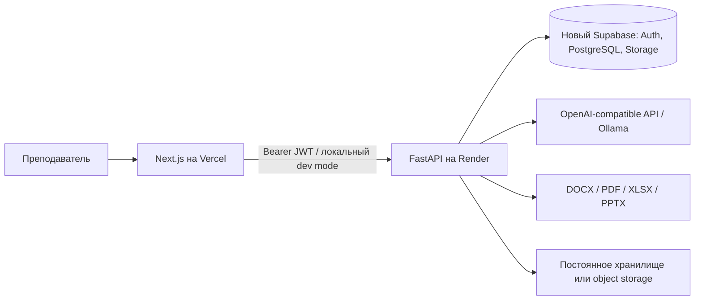

# Архитектура AI EDU 2.0

## Поток основного сценария
1. Next.js получает Supabase session или работает в local dev mode.
2. FastAPI проверяет owner_id и загружает РУП.
3. DOCX/PDF/XLSX преобразуется в структурированные данные.
4. Преподаватель редактирует и подтверждает РУП.
5. Lesson создаётся с одним lesson_id и четырьмя lesson_materials.
6. Координатор запускает Методиста, Креативщика и Ассистента по оцениванию.
7. Результаты сохраняются в БД и могут быть скачаны через API.
